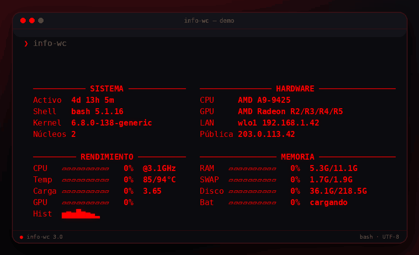

<p align="center">
  
</p>

<p align="center">
  <a href="#instalación"></a>
  <a href="#requisitos"></a>
  <a href="#licencia"></a>
  <a href="#uso"></a>
</p>

<p align="center">
  <strong>System info para terminal. Rojo neón, dos columnas y cero dependencias raras.</strong>
</p>

---

`info-wc` es un panel de sistema para terminal escrito en Bash. Muestra sistema, hardware, rendimiento y memoria en una interfaz roja, con barras animadas y un layout que se adapta al ancho de la terminal.

Repositorio: <https://github.com/swbasmx/info-wc>

## Características

- **Rojo neón real**: `#FF0000` en truecolor, con fallback a 256 y 16 colores.
- **Dos columnas adaptativas**: a partir de 78 columnas; una sola columna en terminales angostas.
- **Barras animadas** para CPU, temperatura, carga, GPU, RAM, swap, disco y batería.
- **Duración de animación ajustable** con `-t SEGUNDOS`.
- **Idioma automático**: detecta `LANG`/`LC_ALL` y permite forzar `es` o `en` con `-l`.
- **Sparkline de CPU** con las últimas 8 muestras.
- **Datos útiles**: kernel, shell, uptime, CPU, GPU, LAN, IP pública, temperatura y batería.
- **Caché de IP pública** con TTL de 15 minutos; `-r` fuerza la actualización.
- **Autoarranque opcional** al abrir una terminal, mediante un bloque marcado en `~/.bashrc`.
- **Instalador idempotente**: no duplica el bloque si ya existe.
- **Respeta tu terminal**: `NO_COLOR`, `TERM=dumb`, redirecciones y el flag `-q`.

## Capturas

<p align="center">
  
</p>

<details>
<summary><strong>Vista en 40 columnas</strong></summary>

<br>

<p align="center">
  
</p>

</details>

> Las IPs de las capturas son de ejemplo; no corresponden a la red del autor.

## Requisitos

- Linux.
- Bash 4+.
- Utilidades estándar: `awk`, `sed`, `df`, `ip` o `hostname`, y acceso a `/proc` y `/sys`.
- Opcionales:
  - `curl` para consultar la IP pública.
  - `lspci` para el modelo de GPU.
  - `nvidia-smi` o `gpu_busy_percent` para el uso de GPU.
  - `/sys/class/power_supply` para la batería.
  - `/sys/class/hwmon` o thermal zones para la temperatura.

## Instalación

```bash
curl -fsSLO https://raw.githubusercontent.com/swbasmx/info-wc/main/install.sh
sudo bash install.sh
```

El instalador descarga `info-wc` desde el repo, lo copia a `~/.local/bin/info-wc` y añade un bloque marcado a `~/.bashrc` para ejecutarlo al abrir una terminal interactiva. No duplica el bloque si ya existe.

Si lo ejecutas con `sudo`, instala para el usuario que lo invocó, no para `root`.

Abre una terminal nueva o recarga tu configuración:

```bash
source ~/.bashrc
```

### Desde el repo

```bash
git clone https://github.com/swbasmx/info-wc.git
cd info-wc
./install.sh
```

### Sin autoarranque

Si solo quieres el comando disponible:

```bash
install -m 755 info-wc ~/.local/bin/info-wc
```

Asegúrate de que `~/.local/bin` esté en tu `PATH`:

```bash
export PATH="$HOME/.local/bin:$PATH"
```

También puedes ejecutarlo directamente desde el repo:

```bash
./info-wc
```

## Uso

```bash
info-wc          # panel animado
info-wc -t 1.5   # animación de 1.5 segundos
info-wc -l en    # salida en inglés
info-wc -q       # sin animación
info-wc -n       # sin consultar la IP pública
info-wc -r       # refresca la IP pública
info-wc -V       # versión
info-wc -h       # ayuda
```

| Opción | Descripción |
| --- | --- |
| `-r`, `--refresh` | Ignora la caché y vuelve a consultar la IP pública. |
| `-n`, `--no-net` | No consulta la IP pública. |
| `-q`, `--no-anim` | Desactiva la animación y deja una salida estática. |
| `-t`, `--time S` | Duración de la animación en segundos (por defecto `0.3`). `0` la desactiva. |
| `-l`, `--lang L` | Idioma: `es` o `en`. Por defecto se detecta desde `LANG`/`LC_ALL`. |
| `-V`, `--version` | Muestra la versión. |
| `-h`, `--help` | Muestra la ayuda. |

## Desinstalación

```bash
curl -fsSLO https://raw.githubusercontent.com/swbasmx/info-wc/main/uninstall.sh
sudo bash uninstall.sh
```

También puedes ejecutarlo desde el repo:

```bash
cd info-wc
./uninstall.sh
```

Elimina `~/.local/bin/info-wc` y el bloque marcado de `~/.bashrc`. No toca el resto del archivo. Si instalaste con `PREFIX` o `BASHRC` personalizados, usa los mismos valores al desinstalar.

## Cómo funciona

- **Ancho**: lee `COLUMNS` o `tput cols`, lo limita a 84 y usa 40 como mínimo.
- **Layout**: con 78+ columnas usa dos columnas: 34 para la izquierda, 3 de separación y el resto para la derecha. Si no, apila todo en una columna.
- **Cabeceras**: líneas `─` con la etiqueta centrada y en negrita.
- **Barras**: `▰` para lo lleno y `▱` para lo vacío; 10 celdas por barra.
- **Animación**: dibuja la regla superior y rellena las barras en 6 pasos; usa `\033[5A` para redibujar sin parpadeo. `-t` ajusta la duración total.
- **Color**: truecolor `255;0;0`, fallback a `196` en 256 colores y `91` en 16 colores. Se desactiva si no hay TTY, si `NO_COLOR` está definido o si `TERM=dumb`.
- **Idioma**: detecta `LC_ALL`, `LC_MESSAGES`, `LANGUAGE` o `LANG`; `-l es|en` lo fuerza. También puedes usar `INFO_WC_LANG`.
- **Caché**: la IP pública se guarda en `${XDG_CACHE_HOME:-$HOME/.cache}/info-wc/public-ip` durante 15 minutos.

## Personalización

Casi todo vive al principio del script:

| Constante | Qué controla |
| --- | --- |
| `BAR_W` | Ancho de las barras. Por defecto, 10. |
| `TTL` | Duración de la caché de IP en segundos. Por defecto, 900. |
| `LEFT_W` | Ancho de la columna izquierda. Por defecto, 34. |
| `GAP` | Separación entre columnas. Por defecto, 3. |
| `C_RED` | Color principal de toda la interfaz. |

Para cambiar el color, edita esta línea:

```bash
C_RED=$(fg 255 0 0)
```

Por ejemplo, para un verde azulado:

```bash
C_RED=$(fg 0 255 180)
```

El fallback de 16 colores está pensado para rojo; ajústalo si cambias el color principal.

## Licencia

MIT. Consulta [LICENSE](LICENSE).

## Créditos

Inspirado por [neofetch](https://github.com/dylanaraps/neofetch). `info-wc` es una implementación independiente, en Bash y sin relación con el proyecto original.
